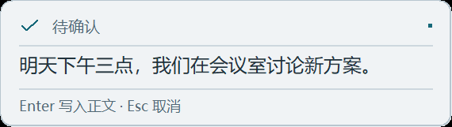
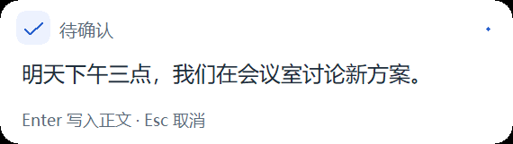

<div align="center">

# Simple Voice · 轻音输入法

**把话说出来，核对后再落笔。**

Windows 本地全拼与语音输入法。干净的界面，明确的确认，留在本机的声音。

[下载 Windows 预览版](https://github.com/code-lawyer/simple-voice/releases/tag/v0.1.0) · [使用说明](#怎么用) · [源码构建](docs/development.md) · [反馈问题](https://github.com/code-lawyer/simple-voice/issues)



</div>

Simple Voice 将全拼和离线中文语音放在同一个 Windows 输入法里。说话时显示草稿，
停顿后完成本地识别定稿、标点与词库校正；**最终文本先留在浮层中，按 Enter 才写入正文**。

当前版本 **v0.1.0 Preview**，仅发布 **Windows x64**。自动化回归和真实模型音频样本
验证已通过；真人麦克风、浏览器与 Codex 的完整使用验收仍待完成。

## 能做什么

- **全拼输入**：基于 Rime 的中文全拼，五项候选，支持空格、数字键和鼠标选词。
- **本地语音**：流式草稿、停顿定稿、自动标点和个人同音词校正，无需账号或云端 API。
- **确认后写入**：语音浮层显示最终文本，支持 Enter 确认、Esc 取消，写入成功后才学习。
- **三套内置皮肤**：钛银、极昼、深空，候选条和语音浮层统一切换，系统高对比度优先。
- **克制的桌面交互**：浮层跟随插入点、不抢焦点；支持长文滚动、快捷键修改和最近记词删除。

校准包含识别定稿、标点和词库纠错；当前没有接入大语言模型，也不会扩写原话或补造内容。

## 安装

1. 下载 [SimpleVoice-v0.1.0-windows-x64.zip](https://github.com/code-lawyer/simple-voice/releases/download/v0.1.0/SimpleVoice-v0.1.0-windows-x64.zip)。
2. **完整解压到准备长期保留的目录**，例如 `C:\Apps\SimpleVoice-0.1.0`。不要在 ZIP 内直接运行。
3. 安装 [Microsoft Visual C++ x64 运行库](https://aka.ms/vc14/vc_redist.x64.exe)（已经安装可跳过）。
4. 双击 `install.cmd`。首次从 sherpa-onnx 官方 Release 下载运行时和三个模型，约 **492 MiB**，并校验 SHA-256；随后在 Windows 管理员提示中允许注册输入法。
5. **注销 Windows 后重新登录**，按 `Win + Space` 选择 **轻音输入法**。

首次下载需要网络；准备好之后，拼音和语音均在本机运行。下载失败可以再次运行
`install.cmd`，已校验的文件会复用。安装脚本在当前目录注册，不会搬动目录或删除个人数据。
UAC 授权请使用同一 Windows 账号。

系统要求：Windows 10（1903+）或 Windows 11、Intel/AMD x64、麦克风；建议至少
8 GB 内存、2 GB 可用磁盘空间。CPU 即可运行，无需独立显卡。当前验证环境是 Windows 11 x64。

如需在注册前检查完整性，可运行 `check.cmd`：它准备并验证依赖、实际加载模型，不打开
麦克风、不注册输入法，也不读写个人词库。

> 发布包不附带模型权重。流式模型的上游页面尚未明确标注再分发许可，因此仅从官方地址
> 下载到使用者本机。模型来源、许可证状态和下载校验见 [第三方说明](THIRD_PARTY_NOTICES.md)。

## 怎么用

| 操作 | 按键 / 入口 |
| --- | --- |
| 中文全拼 | 直接输入拼音；空格选首项，`1`–`5` 选择对应候选 |
| 中英文切换 | 单独按 `Shift` |
| 开始语音 | `Ctrl + Alt + Space`，可在设置中修改 |
| 停录并校准 | 停止说话约 500 毫秒，或在录音中按 `Enter` |
| 写入最终文本 | 等待浮层进入待确认状态，再按 `Enter` |
| 放弃本次语音 | `Esc` |
| 切换皮肤 / 修改快捷键 | 候选条右侧「设置」，或系统托盘菜单 |

语音流程：

```text
开始说话 → 临时草稿 → 停顿 / Enter → 本地校准 → 最终预览 → Enter → 写入正文
                                                   └─ Esc → 丢弃
```

录音中的第一次 Enter 只停录并进入校准；校准中的 Enter 不会预约自动写入。
看到最终文本后，下一次 Enter 才确认。等待正文写入时会暂时锁定重复确认；若无法确认
写入结果，浮层会保留文字并提示先核对正文，避免重复输入。

## 三套皮肤

以下是实际原生窗口截图，三套皮肤共用交互与排版；默认钛银。

| 皮肤 | 语音浮层 | 拼音候选条 |
| --- | --- | --- |
| **钛银** · 冷银灰与深青 |  |  |
| **极昼** · 净白与清蓝 |  |  |
| **深空** · 石墨与冰青 |  |  |

设计规范见 [DESIGN.md](DESIGN.md)。

## 本地数据

不需要登录，不上传音频，不保存录音文件。安装阶段从官方地址下载依赖，日常输入无需联网。

为兼容早期版本，个人数据继续保存在 `%LOCALAPPDATA%\VoiceIme\`：

| 文件 / 目录 | 用途 |
| --- | --- |
| `config.json` | 语音快捷键 |
| `appearance.json` | 所选皮肤 |
| `lexicon.sqlite` | 语音学习词库和待学习记录 |
| `rime\` | 拼音个人词库与 Rime 配置 |

语音学习记录按 **365 天未再次使用**过期清理；旧的无日期语音记录从升级日开始计时。
Rime 的个人拼音数据独立管理，不适用这项语音记录期限。

## 更新、卸载与常见问题

- **更新**：将新版本解压到新目录，运行新目录的 `install.cmd`，注销再登录。保留原数据目录即可沿用词库和设置。不要覆盖应用仍在加载的 DLL。
- **卸载**：在当前安装目录运行 `uninstall.cmd`，允许管理员提示；注销再登录后可删除程序目录。个人数据默认保留，如需彻底清除，可自行备份后删除上述数据目录。
- **没有语音效果**：先运行 `check.cmd`，再检查 Windows「隐私和安全性 → 麦克风」中是否允许桌面应用访问麦克风。
- **输入法列表没有出现**：检查管理员注册是否成功，确认已经注销再登录，并启用简体中文语言配置。
- **应用里仍是旧界面**：已打开应用可能保留旧 DLL；注销再登录可统一刷新。

预览版尚未做代码签名；Windows 可能显示未知发布者提示。当前只提供 x64 输入法 DLL，
不支持 32 位应用、Windows ARM64、macOS 或 Linux。终端、游戏、特殊编辑控件以及跨进程
权限不同的场景尚未完成兼容性验证。请在 [Issues](https://github.com/code-lawyer/simple-voice/issues)
注明 Windows 版本、应用名称、复现步骤和截图；不要提交私密输入内容或个人词库。

## 开发与许可

[构建、测试和打包指南](docs/development.md) · [产品行为](PRODUCT.md) · [v0.1.0 发布记录](docs/releases/v0.1.0.md)

项目代码使用 [Apache-2.0](LICENSE)。第三方代码、词典、运行库和模型分别遵循其原有
许可证，详见 [THIRD_PARTY_NOTICES.md](THIRD_PARTY_NOTICES.md)。

感谢 Rime、sherpa-onnx、ONNX Runtime、cppjieba、pinyin-data、SQLite 及各依赖项目。

---

**English** — Simple Voice is a Windows x64 Chinese pinyin and local voice input method.
Speech is finalized and previewed before you confirm insertion. Three native skins are included.
First-time setup downloads verified upstream models; everyday input works offline.
This first public release is a preview, with human microphone and application acceptance still pending.
