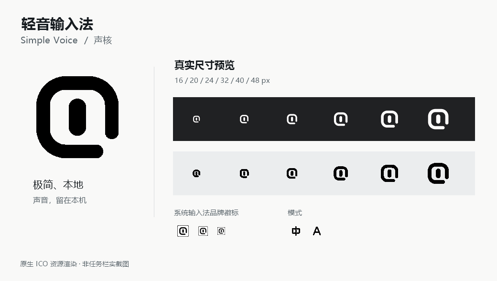

# 声核 · Simple Voice

用户于 2026-11-15 从四个方向中选定 A「声核」。极简、本地是产品定位；开口圆框表达本机空间，中央竖向胶囊表达声音。标记保持静态，不表示正在录音或已经完成识别。

## 使用

- Windows 输入法列表和品牌入口使用黑标白底徽标，避免静态资源在任一任务栏主题中消失。资源固定为 100，通过负资源 ID `-100` 注册。
- 引擎托盘使用透明底标记：深色系统主题白标、浅色主题黑标。皮肤切换不改变品牌形状。高对比模式服从系统前景色明暗。
- 独立的输入模式按钮显示「中」或「A」，点击与 Shift 切换同一输入状态。悬停显示“轻音输入法 · Simple Voice”和当前模式。
- 16、20、24、28、32、40、48、64、128、256 px 均提供 32 位透明 ICO。小尺寸不叠字、不加动画；单色 SVG 用于文档和大尺寸界面。

## 来源与复现

矢量路径由本项目原创，依据用户选定概念重新构建，不包含第三方 Logo。源路径和导出程序在 `tools/build-brand-icons.ps1`；可编辑 SVG 和原生 ICO 在 `assets/brand`；资源表在 `src/brand.rc`。预览由 `tools/render-brand-preview.ps1` 直接载入构建后的 DLL 并通过 Windows `DrawIconEx` 绘制，**不是实际任务栏截图**。

图标采用多尺寸、32 位透明及品牌与模式分离约定。注册使用 `ITfCategoryMgr` 和 `ITfInputProcessorProfileMgr`，迁移旧版完整 HKCU 注册镜像，由系统 API 保存当前用户启用状态。`rc.4` 增加 Windows 终端所需的兼容类别，输入服务仅在有权限的桌面进程访问本地数据。[Microsoft 输入法要求](https://learn.microsoft.com/en-us/windows/apps/develop/input/input-method-editor-requirements)

实机发现 Windows 11 不会按 `TF_LBI_STYLE_TEXTCOLORICON` 为这组 32 位透明模式图标正确换色。因此模式按钮和托盘均明确加载黑/白资源，并在系统主题或显示配置广播后刷新。TSF 使用从不显示、不可激活的顶层工具窗口接收这些广播，不产生新界面或任务栏按钮。

最终安装版的真实任务栏截图：

