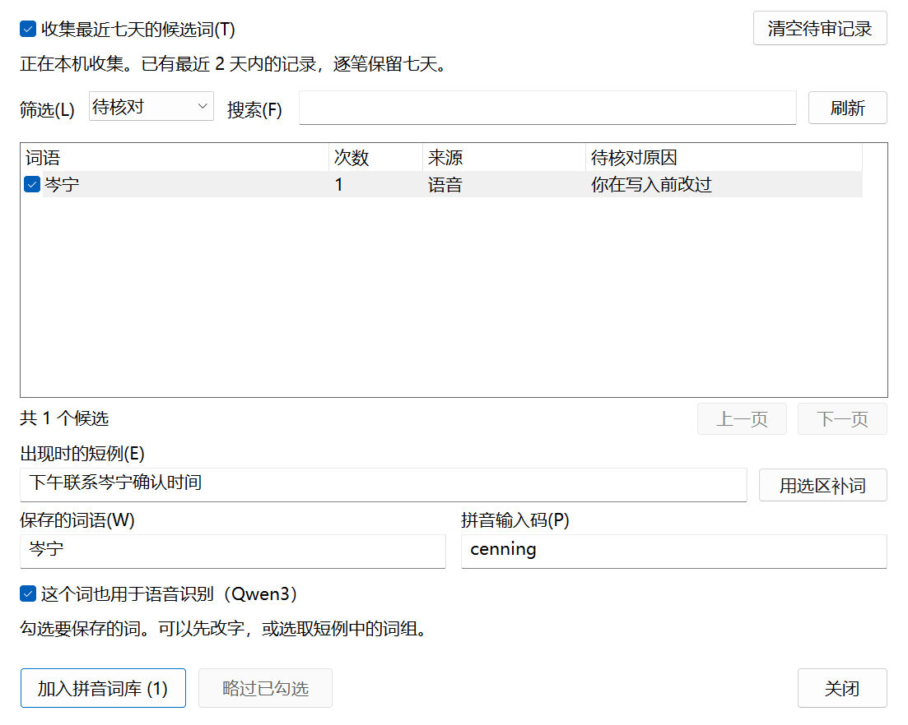
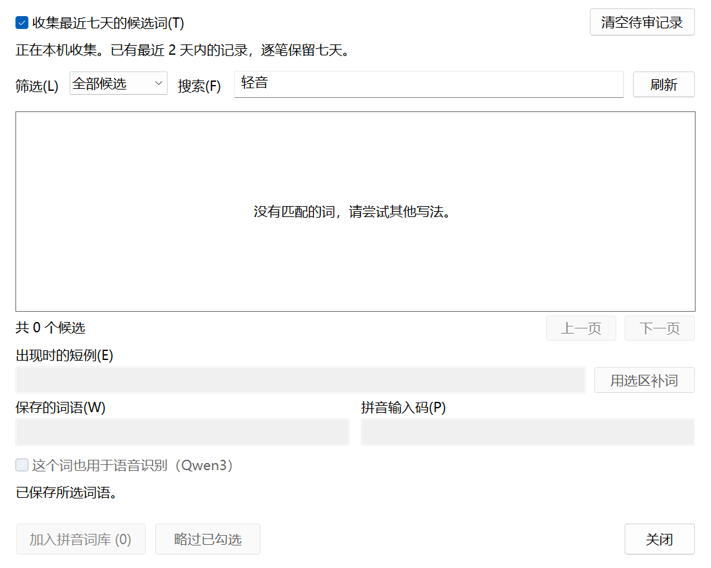

# rc.14 全项目审计与修复验收

2026 年 11 月 23 日，在 Windows x64、Core Ultra 7 255H 上审查 rc.13 工作树和相邻的输入、恢复、安装路径。范围包括项目自有 C++、原生界面、IPC、SQLite、后台采集、构建、打包和回归工具。第三方 Rime、SQLite、cppjieba 与语音模型覆盖到轻音调用它们的边界。

新建构建目录完成 119 个 Release 构建步骤。最终五组 CTest 全部通过，耗时 104.83 秒，包含 102 项单元测试、1,259 项隔离引擎检查、316 项真实 TSF 检查，以及浮层和模型进程回归。钛银、极昼和深空各通过 156 项原生界面检查。

## 正文写入与个人数据

| 复核问题 | 修复结果 | 验证方式 |
| --- | --- | --- |
| 确认后焦点移到同应用的另一个编辑区 | 在确认键绑定 TSF 文档、焦点窗口和当前预览。目标改变时保留文字，用户可重新确认 | 真实 Windows 文本服务和两个隔离编辑区，覆盖切换目标、原目标转只读、重新确认及迟到回执 |
| 拼音引擎断连时组合消失 | 新版组件交换原始拼写。断连时保留输入，当前按键只由宿主处理一次。与旧版组件共用时回退到原有协议 | 真实 TSF 组合、断连、重连、旧握手和显示带分隔符的预编辑 |
| 候选改成现有词的另一输入码也被报告成功，略过后旧回执可重建候选 | 输入码冲突整批回滚，可修改后重试。按回执时间忽略已经处理过的旧记录，仍计入后来真正发生的使用 | 双 SQLite 连接，覆盖同码合并、不同码回滚、同一秒先后发生的操作及七天过期 |
| 数据库持续占用使后台退出时间随积压增长 | 对短暂的锁退避重试。待处理队列有容量限制，遇到持续的锁时整队共用退出期限。容量不足会显示收集不完整 | 数据库锁、积压、退出和 440 词语音中的局部改字 |
| 恢复事务已完成，但只读恢复记录使引擎下次启动失败 | 记录已处理恢复文件的摘要。清理文件受阻时可继续启动，新写入的个人词在后续重启中保留 | 只读恢复记录、再次写入、连续恢复检查及恢复写权限后的收尾 |
| 每次普通写入重复导出个人词表，多个连接还共用同一临时文件 | 只在内容变化或上次同步失败时导出，用同一数据库写事务串行发布完整词表 | 普通输入、词语到期、同步失败后重试和双连接同时导出 |

## 原生界面

1. **拼音选词。** 两个候选原来都截在「今天我们一起讨论…」。先测量每个候选的自然宽度后，「开发计划」和「安排」都能显示。空间不足时仍可通过编号、鼠标或辅助功能选择。

   

2. **停录核对。** 非致命警告与可用的识别文字同时显示。仅有草稿时可以编辑，无稿的设备错误只提示可用操作。长文更新能保留阅读位置，已滚到底部时继续跟随末尾。

   

3. **七天审阅。** 筛选、勾选、看短例和逐词设置语音专名都用原生控件。刷新保留当前词，小窗口可滚动到保存按钮。窗口响应系统配色变化，筛选框有可读标签。

   

4. **保存与继续。** 保存已勾选的词后，另一个尚未勾选的手动修改会保留。筛选结果为空时，列表说明原因，底部保留保存回执。

   

试用录音页按开始、录音和待确认状态启用相应按钮。模型页区分启用其他模型、重新验证当前模型和应用专名修改。截图使用测试词语。原生可访问对象和键盘检查覆盖到控件的标签、焦点和基本操作，屏幕阅读器的实际播报仍待现场验收。

## 声音、安装与工程维护

在有 10,000 条显式词语的隔离词库中，重复输入普通短句。两种操作各预热八次、交替计时 80 次。rc.14 的正常写入中位耗时 0.46 毫秒，P95 为 0.92 毫秒。同一构建强制每次再导出时，中位数为 2.17 毫秒，P95 为 3.50 毫秒。测试前后词表内容对应的文件长度及修改时间均保持一致。这组数字测量词库调用，语音模型定稿另测。[词表测量数据](v0.2.0-rc.14/terms-timing.csv)

开启七天收集后，用现有 Qwen3 权重与隔离引擎按实时速度播放三段音频。每段先预热，再连续测三次，从按停录到原生窗口显示可核对文字。报时短句中位数为 771 毫秒，连续普通话为 856 毫秒，中文停顿后补说 “Hello World” 为 371 毫秒。九次均核对了屏上定稿、实际确认文字与成功回执。三次补说均保留英文尾句。该混合样本在 rc.13 的五次中位数为 1,408 毫秒，跨轮次波动较大，本次三个样本不足以确认慢例的根因或普遍提速。[逐次语音实测](v0.2.0-rc.14/warm-check.csv)

- 连续静音按最近的音频判断。说过话后长时间没有信号时可以看到提示，声音恢复后提示消失。旧中文模型的标点保护按顺序比较数字和英文标识，覆盖把分开的数字连成小数、调换时间和金额分隔符等情况。
- 程序、文本服务、注册器和模型进程共用 Windows 路径读取。安装先检查 VC++ 运行库再下载模型。卸载只要求相关程序、脚本与运行库完整，并继续核对注册归属。
- 合并候选勾选与未保存修改的状态，按实际到期时间刷新记录。已实施的词库规格归入产品说明。发行脚本仅收录本版说明明确引用的验收附件。
- 使用已校验的离线归档测试运行时解压。正常安装和人为设置预期摘要错误两次操作均清理了专属暂存目录，失败后原有的四项运行时文件保持原摘要。
- 从工作区移除了三个旧构建目录和短句实验目录，共 5,298 个文件、2.36 GiB。另清理重复预览截图和空发布暂存目录。已交付版本及其验收资料、安装目录、模型和备份均保留。

解压后的试用包共 83 个文件，含 82 项清单记录和清单本身。四个正式二进制与已测试构建的 SHA-256 一致。复用本机 17 个已校验的模型与运行时文件，包内 `setup.ps1 -Action Check -Offline` 成功加载双语和中文优先两套模型。在独立解压副本中模拟缺失说明文档，完整性检查会报告缺损，卸载预检仍能通过。移走注册程序时，两种预检均会拒绝继续。

## 现场边界

本轮在隔离测试窗口和词库中运行。真实浏览器或 Codex 在多个编辑器之间复用同一 TSF 上下文和窗口时的行为、实体麦克风、混合 DPI 物理屏幕和全新 Windows 安装升级仍待验证。
