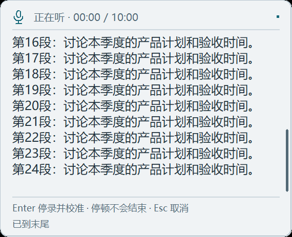
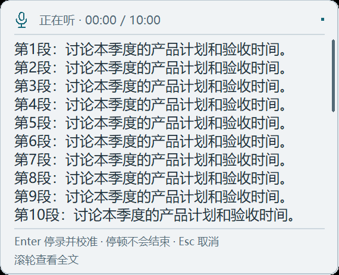

# 轻音输入法代码与原生界面审计

**2026 年 11 月 22 日 · Windows x64 · v0.2.0-rc.12 · `115cbf9`**

下文保留 rc.12 的审计现场。后续版本的修复及复测见 [rc.14 验收记录](../releases/v0.2.0-rc.14-validation.md)。

轻音最值得保留的是同一输入位置里的两种工作方式。用户可以逐字选拼音，也可以先说完一段、检查本地定稿，再决定是否写入。下一版应先保住拼音服务中断前已打的字，让语音只写进确认时选定的输入框，并确保备份恢复后引擎能重新启动。三套皮肤已经能清楚区分文字、状态和选中项，当前视觉改动应优先改善长词辨认、长文阅读和错误恢复。[产品约定](../../PRODUCT.md) · [审计版本](https://github.com/code-lawyer/simple-voice/tree/115cbf9fd7e9576f9fc452ed7b949122eb897c9e)

## 一、验证范围

| 检查 | 本轮结果 | 证据覆盖到哪里 |
| --- | --- | --- |
| 构建与打包 | 全新构建目录，MinGW GCC 16.2.0，Release，完成 113 个 Ninja 构建步骤。发行脚本产出 77 文件的本地测试包并校验清单 | 复用本机已有的 Rime 依赖及语音 SDK。未在干净 Windows 上安装或替换已注册的输入法 |
| 自动测试 | CTest 5/5 通过，用时 93.20 秒。含 98 项单元检查、1,186 项引擎集成检查、221 项真实 TSF 接口检查，以及浮窗和模型子进程测试 | 引擎集成使用合成采音。TSF 使用 Windows 文本服务框架和隔离文档，可验证确实写入了哪个测试文档 |
| 原生前端 | 三套皮肤分别通过同一组 132 项界面检查，各产生 47 张截图。逐图检查覆盖六页设置、候选、草稿、编辑与错误状态，报告收录 20 张代表图 | 图片由新构建的 Win32 窗口绘制，文案与状态来自测试样例。另测了草稿动态更新。高对比度和 DPI 切换使用测试环境 |
| 默认识别方案 | CPU 上运行真实 Qwen3 定稿模型，3 段 4.52–5.61 秒的固定录音均产生预览，确认后文字保持一致。模型加载 4.76 秒，三次停录定稿阶段分别为 1.00、1.06、0.71 秒，模型进程峰值工作集 1,622.5 MiB | 这三条测试检查识别、预览与原样确认的连通性。延迟来自模型测试程序，样本量不足以推算整机端到端延迟或识别准确率 |
| 代码审读 | 重点追踪按键、拼音会话、TSF 写入与回执、后台识别、音频健康、个人词库、恢复、安装和原生 GDI 控件 | 第三方代码按集成边界审查。本轮没有逐行审计上游依赖，也没有实测真人麦克风、物理跨屏、屏幕阅读器或真实浏览器/Codex 编辑器 |

同一提交在 GitHub 上的三次 Windows 构建均成功。最新一次完成 SDK 校验、构建、CTest、三套皮肤的窗口检查和打包，按工作流配置跳过了可选的真实模型测试。发布时可把已有的模型回放设为候选版检查，并随构建保存数字、专名和空转写的结果。依赖清单已有压缩包与关键文件的 SHA-256，仓库也保存了第三方来源与许可说明。[本提交的 CI 结果](https://github.com/code-lawyer/simple-voice/actions/runs/45020376200) · [工作流](../../.github/workflows/windows.yml) · [依赖清单](../../tools/dependencies.json) · [第三方说明](../../THIRD_PARTY_NOTICES.md)

下文把会导致文字丢失、落错位置、引擎无法启动或内存越界的缺陷列为 **P1**。**P2** 影响可读性、恢复操作、输入响应或特定配置下的内容正确性。标为「源码」的结论可以定位触发分支，其出现频率仍待现场衡量。[本轮测试输出节选](rc12-audit-2026-11-22/observations.txt)

## 二、四项优先修复

| 优先级与证据 | 用户会遇到什么 | 原因、修复与验收 |
| --- | --- | --- |
| **P1 · 已复现**　拼音组合被清空 | 在隔离的真实 TSF 文档输入 `nihao`，文档显示组合 `ni hao`。正常关闭该测试引擎后再按 `m`，组合立即清空，按键交回宿主，最终正文只有 `m`。 | 按键交换失败会清空 Rime 视图，TSF 又把空视图当作取消组合。60 毫秒未获响应也走同一分支，本轮实测的是断线。区分传输失败和引擎主动取消，保留能恢复的原始按键。增加输入中断、重连及迟到回复测试，验收已有字母可取回、当前按键只处理一次。[客户端](https://github.com/code-lawyer/simple-voice/blob/115cbf9fd7e9576f9fc452ed7b949122eb897c9e/src/pinyin_client.cpp#L125-L148) · [TSF 组合处理](https://github.com/code-lawyer/simple-voice/blob/115cbf9fd7e9576f9fc452ed7b949122eb897c9e/src/tsf_service.cpp#L1441-L1462) |
| **P1 · 源码**　语音可能写入确认后才聚焦的输入框 | 用户在同一应用的输入框 A 按下最后一次 Enter，若异步写入处理前焦点移到可编辑框 B，当前实现可能把整段文字写进 B 并报告成功。真实应用的发生率未知。 | 引擎记住了确认连接，TSF 到实际执行时才查询当前文档。确认时绑定文档上下文及焦点代次，目标改变时退回预览。验收覆盖「先切到 B 再确认」「在 A 确认后切到 B」「写入 A 后才换焦点、回执迟到」三种顺序。[确认来源](https://github.com/code-lawyer/simple-voice/blob/115cbf9fd7e9576f9fc452ed7b949122eb897c9e/src/engine_main.cpp#L1286-L1299) · [异步投递](https://github.com/code-lawyer/simple-voice/blob/115cbf9fd7e9576f9fc452ed7b949122eb897c9e/src/tsf_service.cpp#L971-L975) · [实际写入目标](https://github.com/code-lawyer/simple-voice/blob/115cbf9fd7e9576f9fc452ed7b949122eb897c9e/src/tsf_service.cpp#L876-L903) |
| **P1 · 已复现**　恢复完成后引擎持续启动失败 | 把一份有效恢复记录的隔离副本设为只读。连续启动两次，引擎两次均以代码 4 退出，日志均为「恢复已完成，但无法清理恢复记录」，记录仍在。正常版在创建托盘和服务连接前就会退出，拼音与语音共用该引擎。 | 把数据恢复成功、收尾失败和数据状态未知作为三种结果处理。保留可验证的恢复副本，清理失败时提供可见的修复入口，在确认一致性后恢复写入。验收包括只读记录、清理后重启及连续重启，检查词库和设置都一致。[恢复事务](https://github.com/code-lawyer/simple-voice/blob/115cbf9fd7e9576f9fc452ed7b949122eb897c9e/src/data_backup.cpp#L89-L106) · [启动顺序](https://github.com/code-lawyer/simple-voice/blob/115cbf9fd7e9576f9fc452ed7b949122eb897c9e/src/engine_main.cpp#L479-L512) |
| **P1 · 源码**　超长用户目录会触发越界读取 | 引擎将 `LOCALAPPDATA` 读进固定的 `MAX_PATH` 数组，再用 API 返回值构造字符串。Windows 在缓冲区不足时返回所需长度，该长度可能超过数组。触发条件是用户目录字符串很长，潜在后果包括启动异常。 | 改用 Windows 已知文件夹 API，或按所需长度分配并重试，并为路径获取失败给出明确反馈。TSF 已对该调用检查上限，适合收敛为一处实现。验收覆盖长路径、缺失路径和非 ASCII 用户名。[引擎取路径](https://github.com/code-lawyer/simple-voice/blob/115cbf9fd7e9576f9fc452ed7b949122eb897c9e/src/engine_main.cpp#L472-L478) · [TSF 现有处理](https://github.com/code-lawyer/simple-voice/blob/115cbf9fd7e9576f9fc452ed7b949122eb897c9e/src/tsf_service.cpp#L59-L64) · [Microsoft API 约定](https://learn.microsoft.com/en-us/windows/win32/api/processenv/nf-processenv-getenvironmentvariablew) |

## 三、代码质量与运行成本

**P2 · 每次成功输入都可能重新生成整份词表。** 拼音写入回执和语音成功写入都在引擎窗口线程调用 `Commit` 和 `ExportTerms`。导出会读取最多一万行，在内存排序、序列化，再读旧文件比对。固定导出权重与使用时间无关，普通输入即使没有改变任何词条，也要走完整条路径。[拼音回执](https://github.com/code-lawyer/simple-voice/blob/115cbf9fd7e9576f9fc452ed7b949122eb897c9e/src/engine_main.cpp#L1243-L1246) · [语音提交](https://github.com/code-lawyer/simple-voice/blob/115cbf9fd7e9576f9fc452ed7b949122eb897c9e/src/engine_main.cpp#L682-L688) · [导出实现](https://github.com/code-lawyer/simple-voice/blob/115cbf9fd7e9576f9fc452ed7b949122eb897c9e/src/lexicon.cpp#L218-L237)

| 显式词语数 | 只提交 P50 / P95 | 提交并导出 P50 / P95 |
| ---: | ---: | ---: |
| 0 | 0.073 / 0.100 毫秒 | 0.257 / 0.314 毫秒 |
| 10,000 | 0.509 / 0.781 毫秒 | **10.282 / 15.599 毫秒** |

同一台 Core Ultra 7 255H，用生产词库代码和本地 SQLite 文件，每组预热 8 次，交替测量两种操作各 80 次。输入文本不命中显式词，导出文件在测试前后内容和修改时间均未发生变化。这段耗时占用引擎线程，尚未测量用户按键到屏幕变化的延迟。建议仅在词条、输入码或到期删除改变导出内容时标记更新，集中处理连续变化。用相同输入集复测耗时，再校验新增、修改、删除、过期和恢复后的词表内容。[测量数据 CSV](rc12-audit-2026-11-22/terms-benchmark.csv)

| 优先级与证据 | 问题 | 建议与验收 |
| --- | --- | --- |
| **P2 · 组件实测** | 麦克风开始时有一次声音，随后持续静音，界面可能一直不给安静提示。向生产检测器送入 20 毫秒信号，再送入 15 秒全零采样，最后电平为 0，静音提示与设备错误都为假。代码记住的是整次会话是否曾有声音。 | 按最近连续静音时长提示，声音回来即清除，保持收音。单独报告采样中断。增加「有声→静音→有声」的时间序列测试。[采音健康检测](../../src/capture_health.hpp) · [界面状态](https://github.com/code-lawyer/simple-voice/blob/115cbf9fd7e9576f9fc452ed7b949122eb897c9e/src/confirm_box.cpp#L150-L157) |
| **P2 · 组件实测，限旧中文 CTC 配置** | 原文保护函数接受了把 `values 1 5` 改成 `values 1.5` 的格式化结果。另一个样例中，时间 `10:30` 与金额 `10.30` 的分隔符互换也被接受。函数只检查每个数字片段能否在结果中任意位置找到。 | 按原文顺序比对数字及边界，覆盖小数、金额、时间、分开的数字和重复数字。这两个样例均来自直接调用保护函数。模型实际输出中是否出现过同类错误，有待回放验证。默认 Qwen3 不走这条外置标点路径。[内容保护](https://github.com/code-lawyer/simple-voice/blob/115cbf9fd7e9576f9fc452ed7b949122eb897c9e/src/recognition_text.cpp#L47-L57) · [模型适用范围](https://github.com/code-lawyer/simple-voice/blob/115cbf9fd7e9576f9fc452ed7b949122eb897c9e/src/model_settings.cpp#L163-L169) |

**发布与维护。** 安装脚本先下载模型再检查 VC++ 运行库，缺依赖的用户可能在大文件下载结束后才发现无法安装。卸载也会先核对全包清单，缺少一个非关键文件就可能阻断退出流程。建议将廉价的依赖、磁盘和缓存检查前移，为受损安装保留可核实注册归属的修复或卸载路径。升级前端还会提示注销重登，项目现行的拼音交接约定要求重启 Windows。应让提示按实际的重启标记生成。[安装与卸载](../../tools/setup.ps1) · [清单检查](../../tools/verify_package.ps1) · [引擎提示](https://github.com/code-lawyer/simple-voice/blob/115cbf9fd7e9576f9fc452ed7b949122eb897c9e/src/engine_main.cpp#L453-L463) · [交接标记](../../src/pinyin_handover.hpp)

**维护时先拆出已经出错的决策。** 目前引擎窗口过程同时决定模型准备、预览警告和文本投递，TSF 服务同时处理编辑会话、按键与异步回执。值得先把「一次确认绑定哪个文档」「一次恢复结束后哪些数据可写」「预览里是转写结果还是设备提示」表达为有类型的状态，再让界面消费这些状态。已有的独立识别进程、提交回执、请求去重和隔离测试可以继续承接回归验证。[引擎](../../src/engine_main.cpp) · [TSF 服务](../../src/tsf_service.cpp) · [引擎集成测试](../../tools/engine_integration.cpp) · [TSF 集成测试](../../tools/tsf_integration.cpp)

## 四、跟着用户走一遍原生界面

### 1. 拼音选词 · 普通词清楚，长候选难以区分

| 输入短词 | 两个共享前缀的长词 |
| --- | --- |
|  |  |

**P2 · 原生截图与文字度量。** 首项是「今天我们一起讨论接下来的开发计划」，第二项是「今天我们一起讨论接下来的安排」，屏幕上两项都成了「今天我们一起讨论…」。选中项、数字键和悬浮提示都可用，但看着屏幕打字的人无法直接选对。按同一夹具在 96 DPI 另行度量，五项自然宽度合计 832 像素，可用 896 像素。现有算法提前给前两项各分 179 像素，尾部还闲置 250 像素。先测全部自然宽度，放得下就完整显示。超出工作区后才压缩，优先让不同词尾可辨。验收同时核对编号、鼠标命中和 100%／150%／200% 缩放。[宽度分配](https://github.com/code-lawyer/simple-voice/blob/115cbf9fd7e9576f9fc452ed7b949122eb897c9e/src/candidate_bar.cpp#L198-L225) · [现有长词夹具](https://github.com/code-lawyer/simple-voice/blob/115cbf9fd7e9576f9fc452ed7b949122eb897c9e/tools/ui_preview.cpp#L207-L215)

### 2. 录音与跟读 · 状态明确，新增草稿会打断阅读

[录音浮层](rc12-audit-2026-11-22/02-listening.png) 同时显示已录时长、10 分钟上限、停止键和取消键。分段的长文本用滚动条承载，减少了遮住编辑器的面积。

| 用户已滚到底部 | 追加一条草稿后 |
| --- | --- |
|  |  |

**P2 · 已复现。** 在 150% 缩放下，用原生浮层显示 24 段草稿。滚到底后追加一条识别更新，滚动位置从 `465/465` 变成 `0/465`。阅读结尾的用户失去最新一段，阅读中段的用户也会丢失位置。当前代码对任何文本变化都把滚动偏移归零。建议在底部时继续跟随末尾，在中间时保留阅读锚点，只在新一轮录音时回到起点。现有测试覆盖换肤和 DPI 变化，需要加入持续出字时的两种位置。[浮层更新](https://github.com/code-lawyer/simple-voice/blob/115cbf9fd7e9576f9fc452ed7b949122eb897c9e/src/confirm_box.cpp#L40-L61)

### 3. 核对、编辑与恢复 · 两次确认清楚，出错时缺少直接操作

| 等待用户决定 | 设备错误 | 收到文字，写入结果待核实 |
| --- | --- | --- |
|  |  |  |

正常路径值得保留。[本地定稿中](rc12-audit-2026-11-22/03-finalizing.png)有独立状态，提前按 Enter 不会预约写入。[预览编辑器](rc12-audit-2026-11-22/03-editor.png)支持修改、恢复识别原文和键盘保存。等不到写入回执时，界面会提示先检查正文，降低重试造成重复文字的风险。

**P2 · 截图与源码。** 设备错误截图同时给出「右键查看设置 / 编辑预览」，但没有文字时菜单并无编辑项。另一个分支中，识别器即使产出了定稿，只要同时返回警告，浮层正文就会被警告替换，Enter 也会被拦下。编辑器内已有键盘操作，而焦点仍在宿主时，键盘路由只提供语音启停、Enter 和 Esc，长预览的编辑入口主要靠右键。建议把「识别文字」「警告及原因」「当前能做的操作」分别呈现。有文字时提供键盘编辑或复制，无文字时显示可执行的设备操作。验收覆盖错误但有稿、错误且无稿、回执未知和纯键盘核对。[浮层内容选择](https://github.com/code-lawyer/simple-voice/blob/115cbf9fd7e9576f9fc452ed7b949122eb897c9e/src/engine_main.cpp#L615-L626) · [定稿警告](https://github.com/code-lawyer/simple-voice/blob/115cbf9fd7e9576f9fc452ed7b949122eb897c9e/src/engine_main.cpp#L768-L774) · [菜单条件](https://github.com/code-lawyer/simple-voice/blob/115cbf9fd7e9576f9fc452ed7b949122eb897c9e/src/engine_main.cpp#L875-L886) · [键盘路由](../../src/key_route.cpp)

### 4. 设置与首次使用 · 六页结构清楚，模型选择和试用反馈可改善

| 页面 | 观察与优先改动 |
| --- | --- |
| [输入偏好](rc12-audit-2026-11-22/04-input.png) · [我的词语](rc12-audit-2026-11-22/04-terms.png) | 导航、页标题、保存区一致，显式词有查询和编辑入口。窄窗口改用可键盘操作的页面选择器，表单滚动时保留底部操作。[窄窗口实图](rc12-audit-2026-11-22/04-compact.png) |
| [语音设备](rc12-audit-2026-11-22/04-device.png) · [使用诊断](rc12-audit-2026-11-22/04-practice.png) | 设备与试用分属两页。初次选择麦克风后应能直接验证输入。当前试用页同时出现「开始 / 停止试用」「确认试用文字」「取消试用」，建议随状态更新主按钮并禁用尚不可执行的动作。[试用控件](https://github.com/code-lawyer/simple-voice/blob/115cbf9fd7e9576f9fc452ed7b949122eb897c9e/src/preferences_view.cpp#L247-L253) |
| [本地模型](rc12-audit-2026-11-22/04-model.png) · [备份恢复](rc12-audit-2026-11-22/04-backup.png) | 模型页已有适用描述、验证及下载状态，当前模型「使用中」时仍显示启用按钮。选择新模型时可提前显示尚需下载的大小、磁盘需求及生效时机。备份页明确列出保存范围，建议把能否安全继续使用也带到启动恢复错误中。[模型状态](https://github.com/code-lawyer/simple-voice/blob/115cbf9fd7e9576f9fc452ed7b949122eb897c9e/src/engine_main.cpp#L1099-L1113) |

**配色与可访问性。** 用生产调色板计算，钛银、极昼、深空的正文与背景对比分别为 11.71、13.84、15.70。此次检查的正文、辅助文字、悬停辅助文字与选中文字组合中，最低为钛银悬停辅助文字的 4.73，高于 WCAG 对一般文字的 4.5 参考值。系统高对比度分支使用 Windows 颜色。实际屏幕阅读器朗读、跨屏缩放与低视力使用体验仍需单独验收。[极昼实图](rc12-audit-2026-11-22/03-daylight.png) · [深空实图](rc12-audit-2026-11-22/03-deep-space.png) · [高对比度分支实图](rc12-audit-2026-11-22/04-contrast.png) · [生产配色](../../src/ui_theme.hpp) · [W3C 对比度标准](https://www.w3.org/WAI/WCAG22/Understanding/contrast-minimum.html)

## 五、开源社区对照

以 2026 年 11 月 22 日 19:11 洛杉矶时间的 GitHub 星标作为累计关注度指标。选择三款支持 Windows 本地听写的项目，以及最接近轻音拼音部分的小狼毫。功能来自官方发行说明、配置和文档。没有对竞品做同机录音回放，因此不作识别率、响应速度或内存排名。[逐项数据、发行日期与官方出处](open-source-comparison-2026-11-22.md)

| 项目 | GitHub 星标 | 对轻音最有用的做法 |
| --- | ---: | --- |
| Handy | 39,749 | 分别处理无模型、纯静音和目标窗口权限等情况。轻音可按失败原因展示用户当下能执行的操作，并在存在转写时保留原文。[发行说明](https://github.com/cjpais/Handy/releases/tag/v0.10.1) |
| OpenWhispr | 12,045 | 模型说明列出下载大小，写入指南说明不同宿主的限制及手工恢复。轻音可以在选模型时交代资源成本，在写入失败时直接提供取回文字的路径。[模型指南](https://docs.openwhispr.com/guides/local-models) · [写入指南](https://docs.openwhispr.com/platform/dictating-into-other-apps) |
| Rime 小狼毫 | 8,331 | Windows 候选配置把字号、标签与布局分别处理。轻音可以先解决长词完整显示，再用同一批候选比较不同布局下的可读性和选词效率。[发行版配置](https://github.com/rime/weasel/blob/0.17.4/output/data/weasel.yaml) |
| CapsWriter-Offline | 7,145 | 中文听写强调数字和热词。轻音可扩展数字、专名和中英混说的回放集，同时检查无关提示词是否被误写，维持用户显式添加专名与最终确认的约定。[官方用法](https://github.com/HaujetZhao/CapsWriter-Offline/blob/v2.6/readme.md) |

项目既有 rc.12 记录提供了优先做识别质量评测的理由。120 段真人英语单数字录音中，61 段意义正确、14 段为空、45 段错误。另用三个普通话合成声音读三个专名，填写提示后命中 5/9。这是两个特定小任务，不能据此推算日常普通话转写准确率。下一轮可将普通话长句、数字金额、相近专名、中英混说、静音分开计分，对同一录音比较启用及关闭提示，并记录首段草稿和停录到可见预览的 P50/P95。[项目既有识别基线](../releases/v0.2.0-rc.12-validation.md)

## 六、建议实施顺序

| 顺序 | 建议交付 | 怎样知道做成了 |
| --- | --- | --- |
| 1 · 下一预发布版 | 修复四项 P1，将断线组合、文档切换时序、恢复收尾和用户目录边界加入回归。 | 输入中的原字可取回。每次语音确认只写到已确认的文档或退回预览。恢复记录异常时有可见的修复入口，异常目录有明确的处理结果。 |
| 2 · 同一轮界面与响应优化 | 修复长候选分宽、草稿滚动和警告遮稿问题，提供预览键盘入口。改进静音检测、旧模型数字保护和词表导出。 | 用本报告的长词、24 段文本、两组数字和本地 SQLite 词库再测。核对截图、键盘操作、P50/P95 和导出词表的内容。 |
| 3 · 稳定版现场验收 | 将安装预检、首次选模型与试用连起来。在真实宿主和设备上验收，完成项目约定的发布签名验证。 | 在干净 Windows、常用 Win32 编辑框、浏览器 textarea／富文本、Codex 编辑器、物理混合 DPI 屏幕及真实麦克风上记录版本、目标文档、文字是否恰好写入一次、恢复动作、耗时和错误。 |
